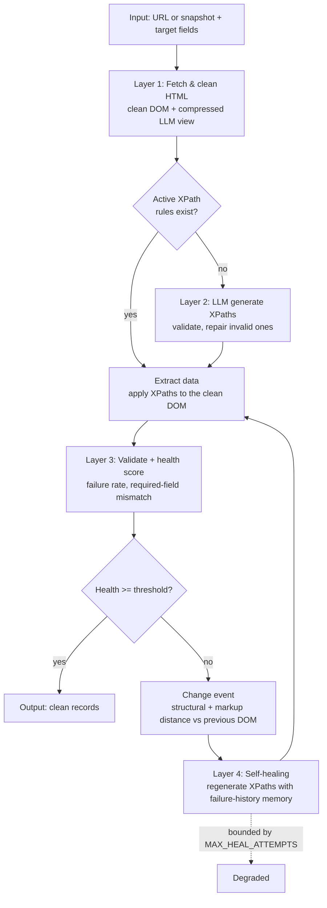

# Architecture

This document describes the design of the self-healing scraper and how it maps
to the research proposal.

## Design goals

1. **Faithful to the proposal** — the four-layer, closed-loop, event-driven
   self-healing architecture (proposal §1.4, Figure A.1).
2. **Framework-agnostic core** — the pipeline and LLM layer have no hard Django
   dependency (only `settings`), so the research logic is independently testable
   and reusable.
3. **Model-agnostic** — a single `LLMProvider` interface; the heuristic, Claude,
   GPT-4, and LLaMA providers are interchangeable.
4. **Runs with zero configuration** — the default heuristic provider makes the
   whole loop demonstrable offline.

## MVC mapping (Django)

- **Model** — `scraper/models.py` (domain + persistence).
- **View (templates)** — `dashboard/templates/dashboard/*`.
- **Controller** — `dashboard/views.py` and the `scraper` management commands.
- **Service / research core** — `scraper/services/*` and `scraper/llm/*`, kept
  separate from the web layer so it can be tested and reused on its own.

## The closed loop



## Layer detail

### Layer 1 — Fetcher (`services/fetcher.py`)
Fetches raw HTML (HTTP, optional headless-browser rendering, or a saved file),
decodes it correctly (header charset, then `<meta charset>`, then UTF-8 — never
the ISO-8859-1 default that garbles Arabic pages), and produces two
deterministic views:

- **clean DOM** (where XPaths are evaluated): `<head>`, scripts, styles,
  comments, SVG/media, form controls, hidden elements (`hidden`,
  `display:none`), ad containers and page chrome are removed. `header`,
  `footer`, `nav` and `aside` are removed only *outside* `<main>`/`<article>`,
  because an article's own header holds the headline, author and date. Forms
  are unwrapped (prices often sit inside them). Body microdata
  (`<meta itemprop=…>`) is kept. Attributes are reduced to a whitelist, empty
  nodes and attribute-less single-child wrappers are removed, and whitespace is
  collapsed. Per site, `prune_keep` can retain any container. Empty rating
  widgets whose class carries the value (`star-rating Three`) are kept.
  With `STRUCTURED_DATA` on (default), the document `<title>`, `<meta>` tags,
  the canonical link and every JSON-LD block are re-inserted at the top of
  `<body>` as `<section id="page-metadata">` (JSON-LD as nested
  `div[@data-key]` elements, numbers kept as written), so fields that exist
  only there can be addressed by XPath.
- **LLM view** (what the model reads): the clean DOM with text truncated to 200
  characters, attribute values to 80, and runs of ≥ 6 near-identical siblings
  (records such as product cards or market rows) collapsed to the first 3 plus
  a marker comment. Runs of label/value rows (a spec table, quote statistics:
  two cells, the first a short non-link label, distinct labels) are never
  collapsed, because every row is a different field. Tags and kept attributes are
  identical, so selectors written on the view work on the clean DOM.

Token counts (tiktoken `cl100k_base`) are recorded for the raw page, the clean
DOM and the LLM view.

### Layer 2 — LLM Analysis (`services/pipeline.py`, `llm/`)
The configured `LLMProvider` receives the LLM view and the field schema
(including whether each field is a single value or a list) and returns
`{field_name: xpath}`. Every returned XPath is **validated** on the clean DOM
(non-empty and type-correct) before it is stored; invalid ones are sent back
with their failure reason for repair, up to `MAX_HEAL_ATTEMPTS` times
(proposal §4.3 step 3). Every call is logged with tokens, pure latency,
rate-limit waiting time, retries, input truncation, prompt hash and version,
and the raw response.

The **heuristic provider** (`llm/heuristic.py`) is the offline default. It splits
matching into two phases that model how brittle selectors behave in practice:
- **Match** — locate the element via synonym-expanded *strong* tokens (so it
  generalises across class renames), nudged by weak description hints and
  type-specific patterns.
- **Emit** — write the XPath using the *specific* class token observed now
  (intentionally rename-fragile). A later redesign breaks it → forcing
  regeneration. This is what makes the self-healing demo real, not scripted.

### Layer 3 — Validation & Change-Detection
- `extractor.py` applies each XPath (single value or list) and classifies success
  vs. a typed failure (`no-match`, `empty-value`, `type-mismatch`,
  `xpath-syntax-error`, `no-rule`).
- `health_monitor.py` computes a health score in `[0,1]`:
  0.6 × (required-field success) + 0.3 × (overall success) + 0.1 × (1 − structural distance).
  These weights are a design choice of this implementation, not values from the proposal.
- `change_detector.py` computes two signals against the previous run's DOM, both
  weighted Jaccard distances over multisets of root-to-node paths (linear time):
  *structural distance* (tag paths; blind to class renames) and *markup distance*
  (paths with class/id tokens; sensitive to renames). They are proxies for
  tree-edit distance and should be described as such.

### Layer 4 — Self-Healing (`services/self_healer.py`, `pipeline.py`)
When health before healing is below the threshold, the orchestrator:
1. stores the pre-heal values and health (the RQ1 detection signals);
2. records the failed XPaths (the **failure-history memory**);
3. logs a `ChangeEvent`;
4. loops up to `MAX_HEAL_ATTEMPTS`: regenerate XPaths for the failed fields with
   the failure memory (current failures first, then recent ones, deduplicated,
   capped at `FAILURE_MEMORY_SIZE`), validate, store only valid ones, re-extract,
   re-score;
5. on recovery marks the run **Healed** and the event **auto-healed**, recording
   time-to-recovery with and without rate-limit waits.

With healing disabled (`--no-heal`, the static baseline) the event is recorded
as `not_attempted`. The loop is always bounded, so it terminates even if a field
cannot be recovered (the run ends **Degraded**). If the LLM fails, ordinary runs
may fall back to the heuristic for that call, always flagged; the evaluation
disables fallback.

## Evaluation harness (`scraper/evaluation/`)

`config.py` validates `eval/sites.yaml`. `protocol.py` runs the paired,
cumulative, seeded design described in `docs/EVALUATION.md`: one DB transaction
per run, with a clean stop and resume when the LLM quota is exhausted.
`gt_io.py` handles ground-truth sheets, `metrics.py` holds pure metric
definitions, `report.py` builds Table 5.1 and RQ1–RQ5, `export.py` writes the
results bundle, and `baselines.py` scores external systems' predictions.

## Data model

```
Experiment 1─* ScrapeTarget (site × condition × repetition)
Experiment 1─* Snapshot ─* GroundTruth           (per page, per field)
Snapshot   ─ parent Snapshot                     (simulated changes chain)
ScrapeTarget 1─* TargetField 1─* XPathRule       (versioned; one active per field)
ScrapeTarget 1─* ScrapeRun ─ Snapshot
             ScrapeRun 1─* ExtractedRecord       (pre_heal and final phases)
                       1─* FailureRecord         (failure-history memory)
                       1─* LLMCallLog            (tokens, latency, waits, fallback)
                       1─* ChangeEvent           (self-healing evaluation log)
```

Rules are **versioned and never deleted**: healing deactivates the old rule and
activates a new version, so the full history of how selectors evolved across
layout changes is kept.

## Configuration

Runtime settings live in `config/settings.py` under `SCRAPER` and can be
overridden by environment variables (see `.env.example`). The evaluation takes
its pipeline parameters from `eval/sites.yaml` and stores the resolved
configuration and environment (package versions, git commit, tokenizer, prompt
version) with the experiment.

## Known simplifications

- Structural and markup distances are path-multiset proxies, not full
  tree-edit distance.
- The health-score weights are a design choice of this implementation.
- Simulated changes are controlled perturbations (the proposal's §4.1
  fallback); natural changes require re-fetching pages over time.
- A single-value field takes the first node an XPath matches.
