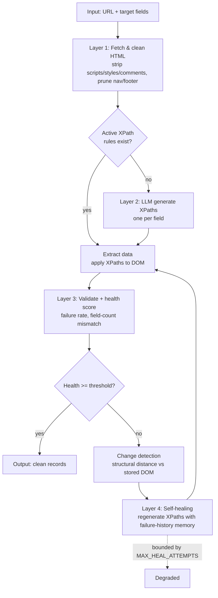

# Architecture

This document describes the design of the self-healing scraper and how it maps
to the research proposal.

## Design goals

1. **Faithful to the proposal** — the four-layer, closed-loop, event-driven
   self-healing architecture (proposal §1.4, Figure A.1).
2. **Framework-agnostic core** — the pipeline and LLM layer have no hard Django
   dependency (only `settings`), so the research logic is independently testable
   and reusable.
3. **Model-agnostic** — a single `LLMProvider` interface; the heuristic, Claude,
   GPT-4, and LLaMA providers are interchangeable.
4. **Runs with zero configuration** — the default heuristic provider makes the
   whole loop demonstrable offline.

## MVC mapping (Django)

- **Model** — `scraper/models.py` (domain + persistence).
- **View (templates)** — `dashboard/templates/dashboard/*`.
- **Controller** — `dashboard/views.py` and the `scraper` management commands.
- **Service / research core** — `scraper/services/*` and `scraper/llm/*`, kept
  separate from the web layer so it can be tested and reused on its own.

## The closed loop



## Layer detail

### Layer 1 — Fetcher (`services/fetcher.py`)
Fetches raw HTML (or accepts injected HTML for tests/demo), then:
- removes `<script>`, `<style>`, comments, inline event handlers;
- prunes non-semantic tags (`nav`, `footer`, `header`, `aside`, `form`, …);
- strips noisy attributes.

Outputs a `FetchResult` with the pruned HTML, a **tag-only DOM skeleton** (used
for change detection), content hashes, and a token-reduction estimate.

### Layer 2 — LLM Analysis (`services/llm_analyzer.py`, `llm/`)
A timed wrapper around the configured `LLMProvider`. The provider receives the
pruned DOM and the field schema and returns `{field_name: xpath}`.

The **heuristic provider** (`llm/heuristic.py`) is the offline default. It splits
matching into two phases that model how brittle selectors behave in practice:
- **Match** — locate the element via synonym-expanded *strong* tokens (so it
  generalises across class renames), nudged by weak description hints and
  type-specific patterns.
- **Emit** — write the XPath using the *specific* class token observed now
  (intentionally rename-fragile). A later redesign breaks it → forcing
  regeneration. This is what makes the self-healing demo real, not scripted.

### Layer 3 — Validation & Change-Detection
- `extractor.py` applies each XPath and classifies success vs. typed failure
  (`no-match`, `empty-value`, `xpath-syntax-error`, …).
- `health_monitor.py` computes a health score in `[0,1]`, weighting required
  fields most heavily, then overall failure rate, then structural stability.
- `change_detector.py` compares the current DOM skeleton to the previous run's
  via a `difflib` sequence ratio (a lightweight tree-edit-distance proxy).

### Layer 4 — Self-Healing (`services/self_healer.py`, `pipeline.py`)
On sub-threshold health the orchestrator:
1. records failures (the **failure-history memory**);
2. logs a `ChangeEvent` (initially unresolved);
3. loops up to `MAX_HEAL_ATTEMPTS`: regenerate XPaths for the failed fields with
   the failure history, version-up the rules, re-extract, re-score;
4. on recovery marks the run **Healed** and the change event **auto-healed**,
   recording time-to-recovery.

The loop is always bounded, so it terminates even if a field is genuinely
unrecoverable (run ends **Degraded**).

## Data model

```
ScrapeTarget 1─* TargetField 1─* XPathRule   (versioned; one active per field)
ScrapeTarget 1─* ScrapeRun   1─* ExtractedRecord
                             1─* FailureRecord   (failure-history memory)
                             1─* LLMCallLog      (tokens / latency)
ScrapeTarget 1─* ChangeEvent (─ ScrapeRun)      (self-healing evaluation log)
```

Rules are **versioned and never deleted**: healing deactivates the old rule and
activates a new version, preserving a full audit trail of how selectors evolved
across layout changes.

## Configuration

All thresholds live in `config/settings.py` under `SCRAPER` and are overridable
by environment variables (see `.env.example`): health threshold, max heal
attempts, failure-memory size, fetch timeout, provider selection and keys.

## Known simplifications (vs. the full thesis)

- Structural distance uses a skeleton sequence ratio, not full tree-edit distance.
- Ground-truth F1 is tracked per field as exact-match; the proposal's full F1
  aggregation over website-time pairs is left as an evaluation step.
- Continuous monitoring is manual/CLI here; a scheduler drives it in production.
